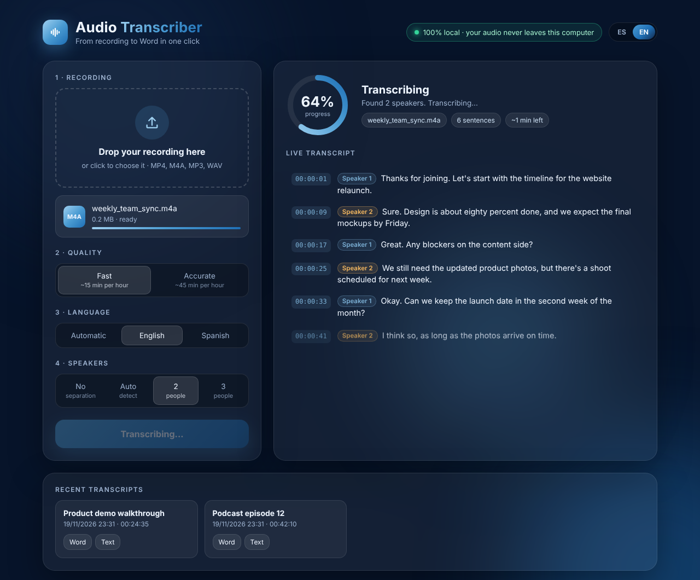
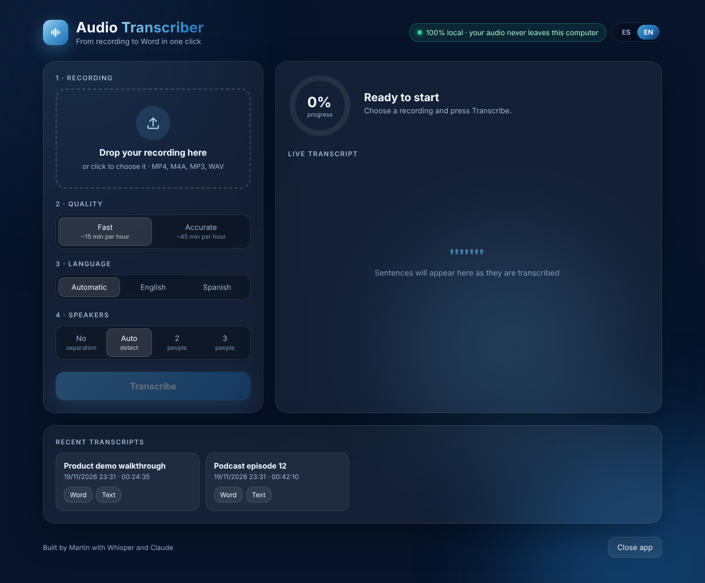
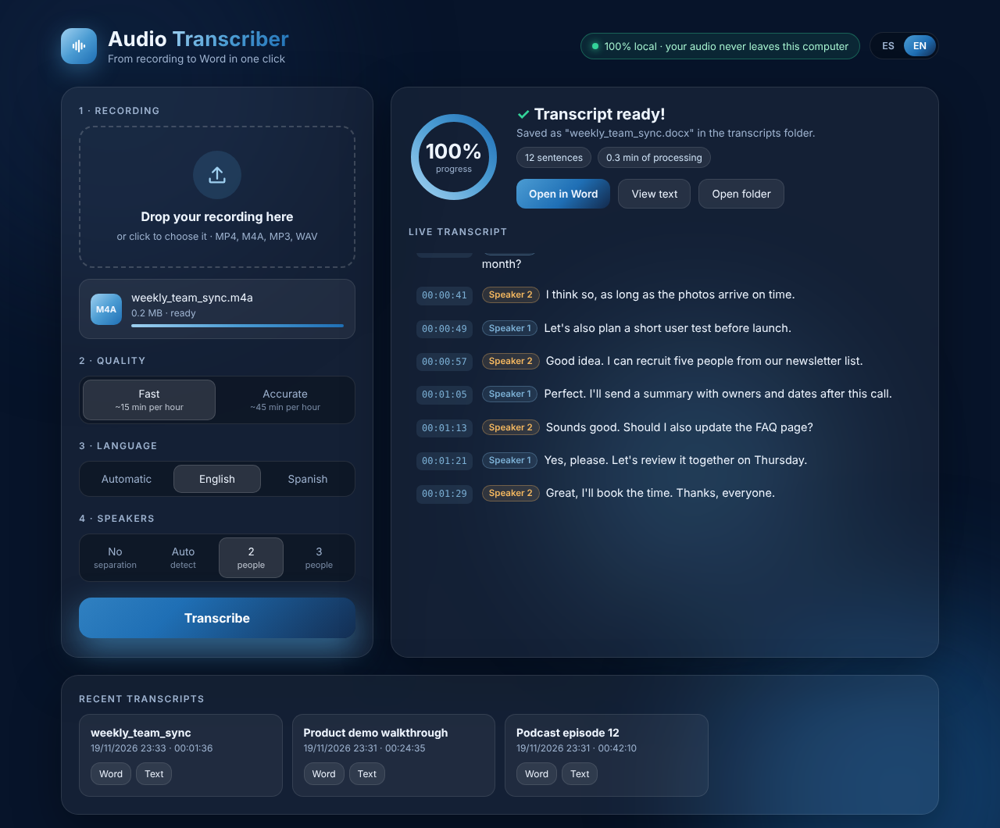

# whisper-transcriber

Free, local tool to transcribe audio recordings into text using OpenAI Whisper.

Everything runs on your own computer: the audio never leaves your machine, there are no subscriptions and no API costs.

## The problem

Most of us record meetings, interviews and calls on our phones, but the built in transcription often falls short:

* Accuracy drops with accents, background noise or conversations that mix Spanish and English
* Names, companies and acronyms (FP&A, EBITDA, P&L) come out wrong
* There is no clear separation of who said what
* The good alternatives are paid subscriptions, and they require uploading private conversations to the cloud

## The solution

A desktop tool that takes a phone recording and turns it into a clean, timestamped transcript with speakers separated, ready to open in Word. It uses OpenAI's Whisper model running locally, so it is free, private and works offline after the first setup.

## What it does

* Transcribes recordings (m4a, mp3, wav, ogg, mp4 and more) into text with timestamps, for example `[00:12:45]`
* Works in Spanish, English or auto detected language
* Two quality levels: fast for everyday use, precise for important recordings
* Optional speaker separation (who spoke when) using sherpa-onnx
* Custom vocabulary list so names, companies and acronyms are spelled correctly
* Simple browser interface that runs locally (localhost), plus a command line option
* Exports to text and Word

## Screenshots

| Ready to start | Transcript ready |
|---|---|
|  |  |

## How to use it (Windows)

1. Install Python 3.13 (64 bit, x64) from python.org. On ARM laptops such as Surface, choose the x64 installer, not ARM64.
2. Double click `instalar.bat` (first time only). It creates a private environment and installs `faster-whisper`.
3. Double click `Abrir Transcriptor.bat` to open the interface, or put audio files in `grabaciones/` and run `transcribir.bat`.
4. Results are saved in `transcripciones/`.

Detailed instructions in Spanish are in `LEEME.txt`.

## Files

| File | Purpose |
|---|---|
| `app_web.py` + `interfaz.html` | Local browser interface |
| `app.py` | Transcription engine and Word export |
| `transcribir.py` | Command line batch transcription |
| `voces.py` | Speaker separation |
| `vocabulario.txt` | Words Whisper should spell correctly |
| `prompt_para_claude.txt` | Prompt to analyze a transcript with Claude |

## Built with

Python, [faster-whisper](https://github.com/SYSTRAN/faster-whisper), [sherpa-onnx](https://github.com/k2-fsa/sherpa-onnx)
